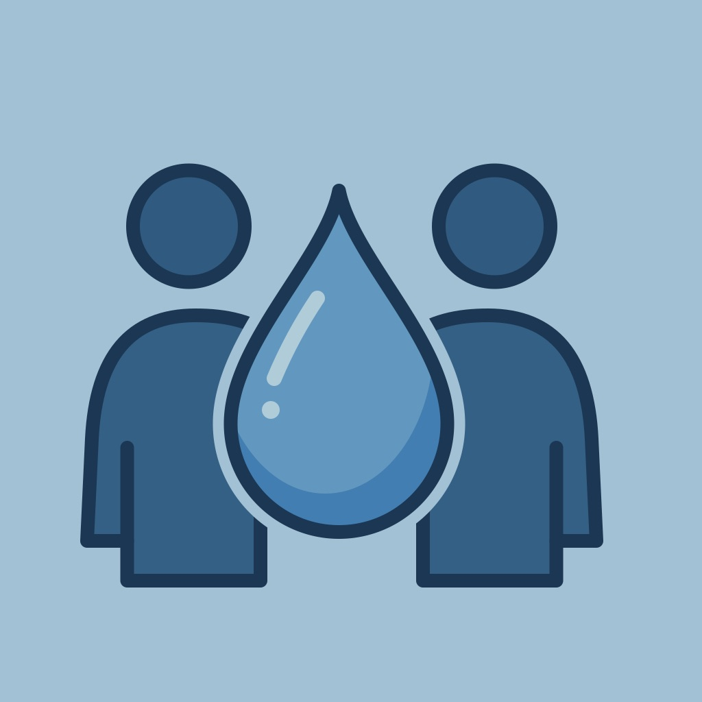
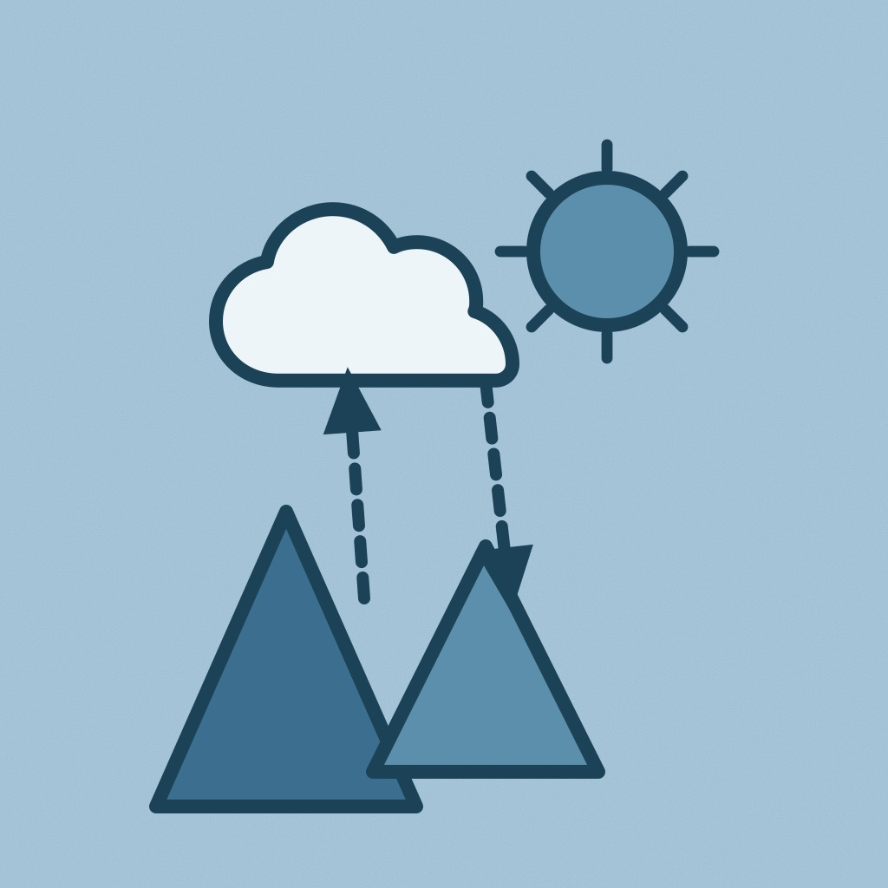
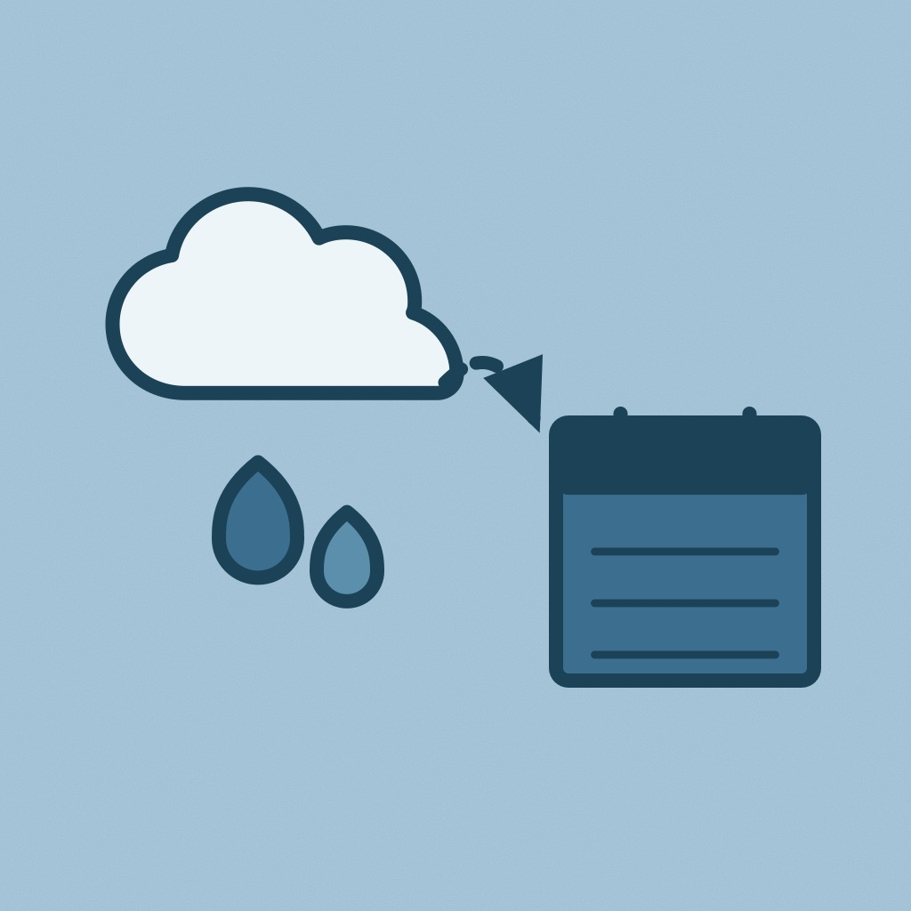
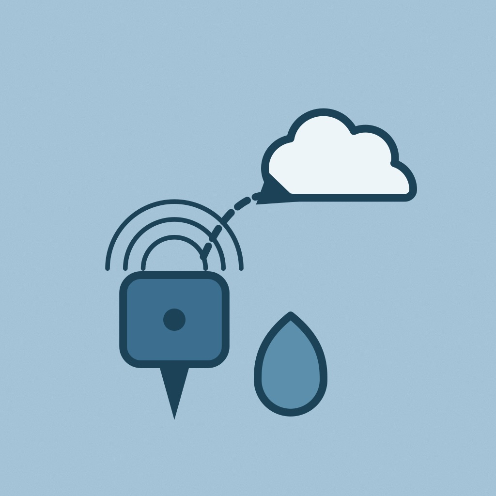

# Sesiones temáticas

  

    

      
<h3>Sesión 1: "Sociohidrología: gobernanza, participación y decisiones sobre el agua"</h3>

    <h5><i>Convener:</i> Anahí Ocampo (Facultad de Ciencias Forestales y de Conservación de la Naturaleza, Universidad de Chile)</h5>
    <h5><i>Co-conveners:</i> María Cristina Fragkou (Facultad de Arquitectura y Urbanismo, Universidad de Chile), Carlos Guzmán (Departamento de Ingeniería Hidráulica y Ambiental (DIHA), Pontificia Universidad Católica de Chile)</h5>
    
    

    En esta sesión se presentarán trabajos con enfoques interdisciplinarios orientados a comprender los complejos problemas del agua desde la inclusión de la dimensión humana  como parte indivisible del ciclo hidrológico. En particular, se invita a propuestas que exploren las interacciones dinámicas entre los sistemas hídricos y las sociedades humanas, analizando la retroalimentación bidireccional entre las decisiones sociales y la disponibilidad y gestión del agua.
    

    

    Se considera la presentación de trabajos que aborden los siguientes temas:
    

    <ul>
      <li>Metodologías y enfoques para la integración social y ambiental en la exploración de problemas de la hidrología.</li>
      <li>Modelación hidrológica participativa, <i>agent-based modeling</i>, y decisión multicriterio para la gestión de cuencas.</li>
      <li>Aspectos socioculturales de los problemas del agua en enfoques de Servicios ecosistémicos, capital natural y valores del agua.</li>
      <li>Estudios de gobernanza del agua, justicia ambiental y adaptación en las cuencas.</li>
      <li>Integración de conocimientos, datos y toma de decisiones, ciencia ciudadana.</li>
    </ul>
    

  

  

    

      
<h3>Sesión 2: "Procesos hidrometeorológicos: dinámica superficie–atmósfera en montaña, valle y costa"</h3>

    <h5><i>Convener:</i>: Sebastián Krögh (Departamento de Recursos hídricos, Universidad de Concepción)</h5>
    <h5><i>Co-conveners:</i>: Lucía Scaff (Departamento de Geofísica, Universidad de Concepción), Camila Álvarez (Centro de Ciencia del Clima y la Resiliencia, CR2)</h5>
    
    

    Esta sesión se centra en la relación de fenómenos meteorológicos con la hidrología y sus procesos a distintas escalas espaciales (ladera, cuenca y sinóptica) y temporales (subdiaria, diaria, mensual e interanual). Se presentarán análisis empíricos de observaciones hidrometeorológicas y modelación numérica en sistemas de montaña, el valle central y zonas costeras, con el fin de mejorar la comprensión y caracterización de procesos físicos dominantes bajo condiciones climáticas históricas y escenarios de cambio climático y uso de suelo. Así también, se espera contar con aplicaciones de modelos hidrológicos, meteorológicos y de interacción superficie-atmósfera para análisis de diagnóstico de eventos extremos, disponibilidad hídrica e interacción entre procesos.
    

    

        Se considerarán trabajos en torno a las siguientes líneas:
    

    <ul>
      <li>Diagnósticos y cuantificación empírica de interacciones superficie-atmósfera basado en observaciones.</li>
      <li>Estudios de fenómenos meteorológicos: variación de la Isoterma 0°C, gradiente orográfico de precipitaciones, inversiones térmicas, ciclos diurnos, entre otros.</li>
      <li>Análisis de procesos hidrológicos, disponibilidad hídrica y análisis de eventos extremos, utilizando modelación hidrológica acoplada con modelación atmosférica.</li>
      <li>Impacto del cambio climático en procesos hidrometeorológicos y los recursos hídricos.</li>
    </ul>
    

  

  

    

      
<h3>Sesión 3: "Pronóstico hidrometeorológico: métodos, desempeño e incertidumbre"</h3>

    <h5><i>Convener:</i>: Paul Muñoz (Departamento de Recursos Hídricos, Universidad de Concepción)</h5>
    <h5><i>Co-conveners:</i>: Cristián Chadwick (Universidad Adolfo Ibáñez), María de los Ángeles Ibáñez (Pontificia Universidad Católica de Chile)</h5>
    
    

        Esta sesión se centrará en avances científicos y metodológicos para el pronóstico de variables hidrometeorológicas en diferentes escalas espaciales y temporales, así como en la evaluación y mejora de su desempeño. Se invita a presentar contribuciones que aborden el desarrollo, implementación y evaluación de sistemas y metodologías de pronóstico, desde enfoques basados en procesos físicos hasta métodos estadísticos, aprendizaje automático e inteligencia artificial.
    

    

    Se consideran, entre otros, los siguientes temas:
    

    <ul>
      <li>Pronósticos determinísticos, probabilísticos y por conjuntos de variables hidrológicas y meteorológicas, desde el <i>nowcasting</i> (horas), pronósticos de plazo intermedio (días), hasta horizontes de mayor plazo (semanas o meses).</li>
      <li>Modelos de pronóstico basados en procesos, estadísticos, de aprendizaje automático e inteligencia artificial, incluyendo enfoques híbridos y acoplados.</li>
      <li>Asimilación de datos, postprocesamiento, corrección de sesgo y combinación de pronósticos y productos de predicción numérica del tiempo.</li>
      <li>Predictibilidad, verificación y cuantificación de la incertidumbre de los pronósticos.</li>
      <li>Pronóstico de eventos hidrometeorológicos extremos, sistemas de alerta temprana y aplicaciones para la toma de decisiones.</li>
    </ul>
    

  

  

    

      
<h3>Sesión 4: "Eco-hidrología y gestión ambiental: ecosistemas, calidad y caudales ecológicos"</h3>

    <h5><i>Convener:</i> María Sol Lisboa (Departamento de Obras Civiles, Universidad Técnica Federico Santa María)</h5>
    <h5><i>Co-conveners:</i>: Cristina Contreras (Departamento de Obras Civiles, Universidad Técnica Federico Santa María), Karina Soto (Departamento de Obras Civiles, Universidad Técnica Federico Santa María), Marcos Machioli (Instituto de Ciencias Agroalimentarias, Animales y Ambientales, Universidad de O’Higgins)</h5>
    
    

    Esta sesión reúne trabajos que estudian las relaciones entre los procesos hidrológicos y los sistemas ecológicos, y cómo ese conocimiento se traduce en decisiones de gestión, regulación y conservación. Se invitan contribuciones que muestren cómo las observaciones de campo, el monitoreo de calidad y cantidad de agua, la teledetección y el modelamiento permiten definir caudales ambientales, evaluar el estado de los ecosistemas acuáticos y ribereños, diseñar acciones de restauración y respaldar instrumentos normativos. Interesan especialmente los casos de Chile y la región, en un contexto de megasequía, presión creciente sobre las cuencas y nuevas exigencias legales para proteger el agua en su dimensión ecosistémica.
    

    

    Se considerarán trabajos que se enmarquen en los siguientes ejes temáticos:
    

    <ul>
      <li>Ecohidrología: interacciones agua–vegetación–suelo, humedales, vegas y bofedales altoandinos, bosques y rendimiento hídrico, y aguas subterráneas que sostienen ecosistemas.</li>
      <li>Calidad de aguas: monitoreo fisicoquímico y biológico, contaminantes emergentes, drenaje ácido y minería, nutrientes y eutrofización, e indicadores biológicos.</li>
      <li>Caudales ecológicos: metodologías de estimación, aplicación del caudal ecológico mínimo tras la reforma al Código de Aguas (Ley 21.435) y régimen de caudales más allá del valor mínimo.</li>
      <li>Restauración hidrológica: restauración de ríos, humedales y cuencas, soluciones basadas en la naturaleza, y evaluación de efectividad con datos.</li>
      <li>Ecosistemas bajo estrés hídrico: impacto ecológico y la respuesta de gestión ante sequías, variaciones en salares y humedales frente a la extracción, y conectividad fluvial.</li>
      <li>Hidrología para la gestión ambiental: apoyo técnico al SEIA, normas secundarias de calidad, humedales urbanos y planes estratégicos de recursos hídricos en cuencas.</li>
    </ul>
    

  

  

    

      
<h3>Sesión 5: "Proyecciones hidroclimáticas: escenarios futuros e impactos del cambio climático en los recursos hídricos"</h3>

    <h5><i>Convener:</i> Miguel Lagos Zúñiga (Departamento de Obras Civiles, Universidad Técnica Federico Santa María, Centro de Investigación Interdisciplinaria en Riesgo, Resiliencia y Recuperación ante Desastres (CIGIDEN R+)</h5>
    <h5><i>Co-conveners:</i> Lucía Scaff (Departamento de Geofísica, Universidad de Concepción), Marcia Paredes (Advanced Mining Technology Center, Universidad de Chile), Cristian Martínez Villalobos (Universidad Adolfo Ibáñez)</h5>
    
    

    El cambio climático y la variabilidad climática natural plantean nuevos desafíos para la comprensión, cuantificación y gestión de los recursos hídricos. En este contexto, los estudios hidroclimáticos permiten avanzar en la caracterización de la variabilidad de los sistemas hidrológicos, en la comprensión de sus principales procesos y en la evaluación de sus posibles cambios bajo distintos escenarios climáticos.
    

    

    Esta sesión busca reunir investigaciones que presenten avances metodológicos y aplicaciones en estudios hidroclimáticos, incorporando tanto el análisis de condiciones históricas y actuales como la evaluación de posibles cambios futuros. Se invita a presentar trabajos relacionados con observaciones y proyecciones hidroclimáticas, corrección de sesgos, uso de modelos climáticos de alta resolución, evaluación de impactos del cambio climático sobre los recursos hídricos, y nuevas metodologías para su cuantificación y la caracterización de incertidumbre. Finalmente, la sesión busca promover el intercambio de conocimientos y experiencias entre investigadores y profesionales que abordan los desafíos de la hidrología en un contexto de cambio climático, considerando tanto cambios en la disponibilidad y eventos extremos, como sus impactos en la planificación y gestión de infraestructura hídrica.
    

    

  

  

    

      
<h3>Sesión 6: "Tecnología, datos y aplicaciones operacionales en hidrología"</h3>

    <h5><i>Convener:</i> Eduardo Muñoz-Castro (Institute for Atmospheric and Climate Science, ETH Zurich)</h5>
    <h5><i>Co-conveners:</i> Valentina Medel (Departamento de Geología, Universidad Santo Tomás); Daniel Ugalde (Senapred RM, Ministerio del Interior); Jorge Gironás (Departamento de Ingeniería Hidráulica y Ambiental, Pontificia Universidad Católica de Chile); Trinidad Henríquez (Departamento de Obras Civiles, Universidad Técnica Federico Santa María)</h5>
    
    

    Esta sesión busca destacar aplicaciones innovadoras que mejoren la observación y la comprensión de la hidrología, fortalezcan la predicción y apoyen la toma de decisiones ante problemáticas como la disponibilidad y la seguridad hídricas, los eventos extremos y la adaptación al cambio climático. En particular, se buscan contribuciones orientadas al desarrollo y la aplicación de nuevas herramientas, metodologías y tecnologías para abordar los desafíos actuales y emergentes en las ciencias hidrológicas.
    

    

    Los trabajos enviados a esta sesión pueden abarcar, por ejemplo, las siguientes temáticas:
    

    <ul>
      <li>Decisiones operacionales basadas en pronósticos y lecciones aprendidas de proyectos reales.</li>
      <li>Experiencias en el análisis de impactos generados por amenazas hidrometeorológicas (e.g., sequías, crecidas, avalanchas y aluviones), y en la gestión de riesgos pre y post contingencias y su mitigación.</li>
      <li>Estudios inter- y transdisciplinarios entre la academia, los sectores público y privado y las comunidades para la gestión de los recursos hídricos.</li>
      <li>Nuevas metodologías para el diseño y la verificación de la infraestructura hidráulica en un contexto de variabilidad climática.</li>
      <li>Tecnologías para el monitoreo de variables hidrometeorológicas (e.g., sensores de bajo costo).</li>
      <li>Plataformas y bases de datos de apoyo para el estudio de variables hidrometeorológicas y del ciclo del agua en Chile.</li>
    </ul>
    

  

